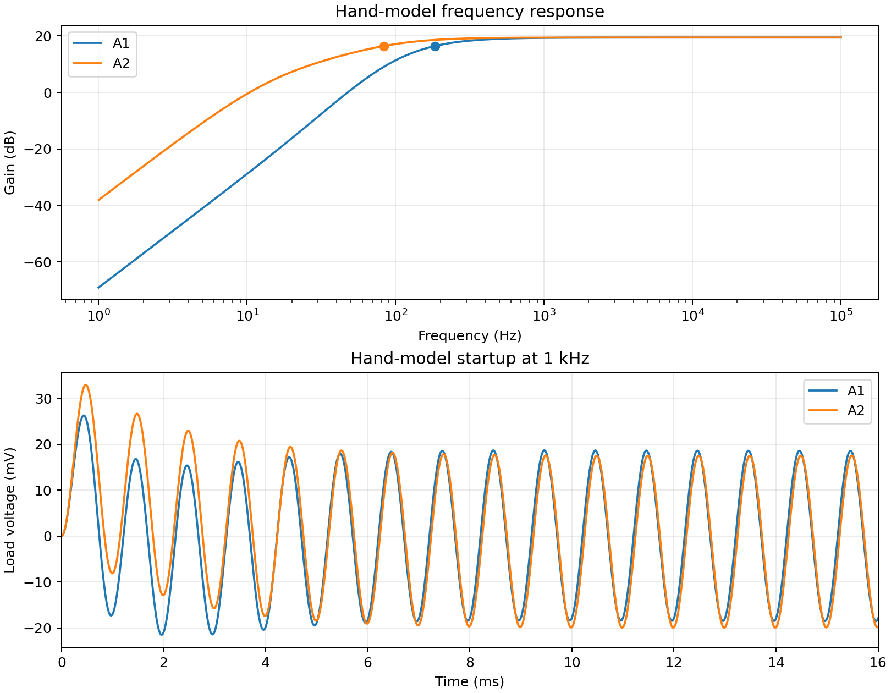
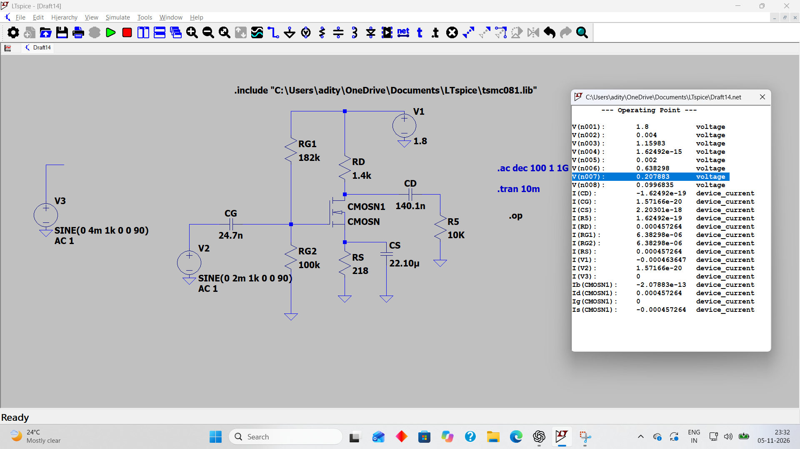

# 1.8 V common-source NMOS amplifier in 180 nm CMOS

This case study follows my 1.8 V amplifier from device sizing through hand calculations and LTspice verification. I used a 10 kΩ load and aimed for about 20 dB gain, a lower cutoff near 100 Hz, and under 1 mW of DC power.

The project covers the 1.8 V Draft14 design and its earlier 1.8 V Draft6 capacitor trials. A1 and A2 compare two coupling-capacitor configurations of this 1.8 V amplifier.

## Read the project in this order

| Step | What the calculation answers |
|---|---|
| 1. [Specifications](design-calculations.md#1-what-i-wanted-to-build) | What does the amplifier have to do, and which values did I choose? |
| 2. [Gain and current budget](design-calculations.md#2-start-from-gain-and-power) | How much current is available after accounting for the bias divider? |
| 3. [Transistor sizing](design-calculations.md#3-work-backward-from-gmid-to-device-size) | How does the chosen gm/ID give the overdrive and the 93.6 µm width? |
| 4. [Resistors and DC bias](design-calculations.md#4-derive-the-resistors-and-solve-the-actual-dc-bias) | How do gain and voltage headroom set the resistor estimates? Where does the actual circuit bias? |
| 5. [Device transit frequency](design-calculations.md#5-correct-the-device-transit-frequency-estimate) | What does the corrected fT estimate say about device speed? |
| 6. [AC gain and cutoff](design-calculations.md#6-capacitors-and-the-combined-ac-response) | How does the KCL matrix combine the effects of the three external capacitors? |
| 7. [Transient and settling](design-calculations.md#7-transient-calculation-and-initial-conditions) | Why are the first few cycles different, and how are the exponential coefficients calculated? |
| 8. [Verification and trade-offs](design-calculations.md#8-verification-and-interpretation) | How closely do the calculations match LTspice, and what changes with larger coupling capacitors? |

The [typed worked notes](design-calculations.md) contain the equations and substitutions. The [handwritten appendix](notes/README.md) preserves all 38 original pages and maps them to the relevant typed sections.

## Results at a glance

| Historical LTspice result | Value |
|---|---:|
| Draft14 drain current | 457.264 µA |
| Draft14 DC power | 0.835 mW |
| Draft14 midband gain | 19.64 dB |
| Original capacitor configuration | Lower cutoff near 200 Hz |
| Revised capacitor configuration | Lower cutoff near 102 Hz, based on an earlier plot |
| Original 1 kHz transient | About 38 mV peak-to-peak for 4 mV peak-to-peak input |

Increasing the input and output coupling capacitors brought the lower cutoff closer to the target while preserving midband gain approximately. The [worked design notes](design-calculations.md) show the sizing equations, power accounting, bias comparison, matrix solution, pole and zero calculations, and startup coefficients.

The figure shows analytical predictions. The [historical LTspice evidence](results/evidence.md) records the separately obtained simulator results.

[Open the full-size Draft14 operating-point screenshot](results/screenshots/draft14/01-op.png).

## Reproduce the calculations

Run `python -m pip install -r requirements.txt` and `python scripts/analyze.py`. The script solves DC bias, builds the nodal matrix, finds the cutoff and poles, calculates the startup terms, and generates the corrected [device sizing and transit-frequency figure](results/gmid-ft-corrected.png).

The two [simulation decks](simulations/README.md) specify a controlled A1/A2 comparison with grounded bulk. They require the separately obtained model card. The historical results predate that controlled setup.

The [original width calculation](notes/width-derivation.jpg) documents the 93.6 µm width used in Draft14.
