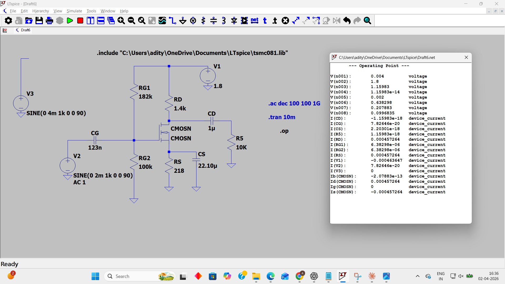
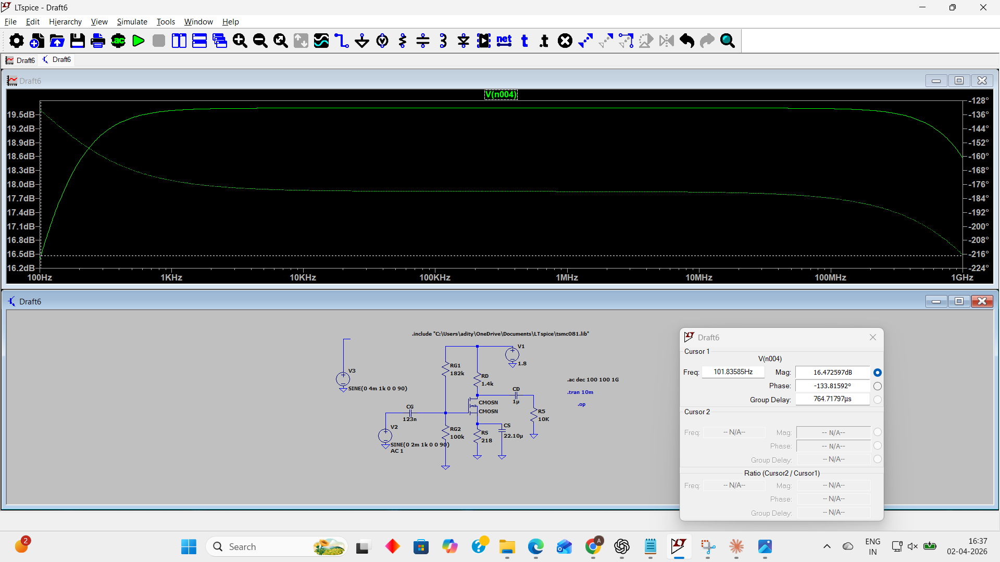

# Selected 1.8 V simulation evidence

These are the original, full-size screenshots. They have not been cropped. Both show CG = 123 nF, CD = 1 µF and CS = 22.10 µF.

## 1. DC operating point

Read ID = 457.264 µA, VG = 0.638298 V, VS = 0.0996835 V and VD = 1.15983 V. Supply current is 463.647 µA, including the divider. Thus power is 1.8 × 463.647 µA = 0.8346 mW. A printed voltage for n007 does not by itself prove the intended bulk connection; check the netlist.

## 2. AC frequency response

The cursor reads 101.83585 Hz and 16.472597 dB. The flat gain is about 19.6 dB. The cursor is near the lower half-power point. For an exact cutoff, find a gain 3.0103 dB below the plateau in this same run.

At 1 GHz, the gain is still above that half-power level. The exact upper cutoff has not been captured.

## 3. Transient verification

A transient capture showing this exact capacitor set has not been verified. Screenshots from other capacitor sets have been removed rather than used as evidence for this run. The [worked notes](../design-calculations.md) give the predicted amplitude and startup calculation, labelled as hand-model predictions.
